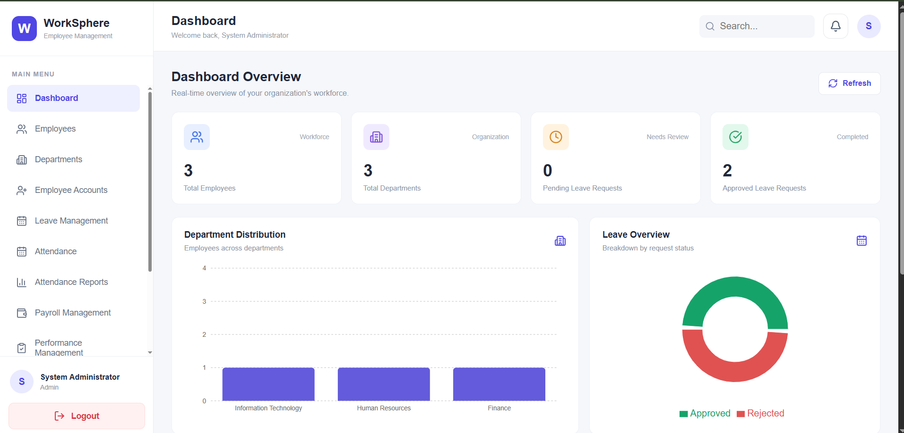
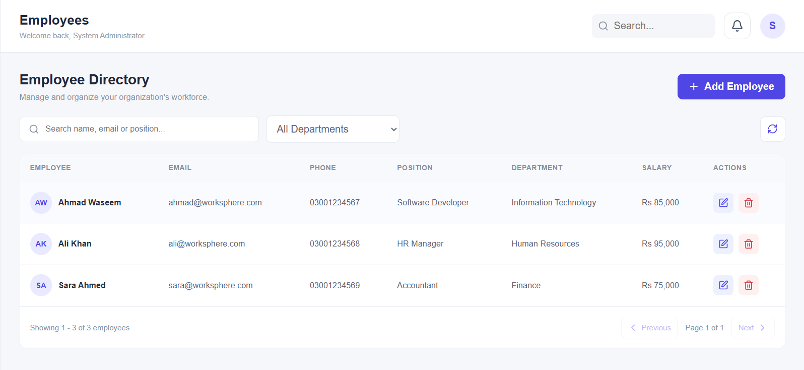
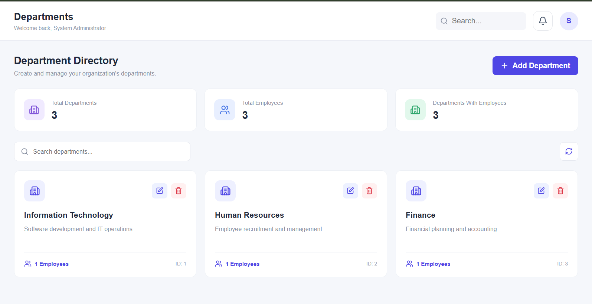

# WorkSphere – Employee Management System

WorkSphere is a full-stack Employee Management System designed to simplify and centralize HR operations. It provides tools for managing employees, departments, attendance, payroll, performance reviews, recruitment, onboarding, and offboarding through a modern web interface.

The application is built using **ASP.NET Core Web API, React, Entity Framework Core, and Microsoft SQL Server**.

## Features

### 1. Dashboard & Analytics
- Overview of employee and HR statistics.
- Department distribution charts.
- Leave analytics and recent activity.
- Dashboard data refresh.

### 2. Employee Management
- Create, view, update, and manage employee records.
- Search and department-based filtering.
- Pagination.
- Employee account linking.

### 3. Department Management
- Create and manage departments.
- View department employee counts.
- Prevent deletion of departments with assigned employees.

### 4. Authentication & Authorization
- JWT-based authentication.
- ASP.NET Core Identity.
- Role-based access control.
- Admin, HR, and Employee roles.
- Protected API endpoints.

### 5. Leave Management
- Submit and manage leave requests.
- Approve or reject requests.
- Track leave request statuses.
- Employee self-service leave management.

### 6. Attendance Management
- Employee check-in and check-out.
- Automatic Present and Late status calculation.
- Manual absence marking.
- Attendance history and reports.
- Pakistan timezone support.

### 7. Payroll Management
- Generate monthly payroll records.
- Calculate salary components.
- Edit unpaid payroll records.
- Mark payroll as paid.
- Generate and print payslips.
- Employee self-service payslip access.

### 8. Performance Management
- Create and manage review cycles.
- Create and update performance reviews.
- Publish employee performance reviews.
- Employee self-service performance history.

### 9. Recruitment Management
- Create and manage job vacancies.
- Review candidate applications.
- Track application statuses.
- Schedule and manage interviews.
- Upload and download candidate resumes.

### 10. Public Career Portal
- Publicly accessible job listings.
- Search and filter vacancies.
- View vacancy details.
- Submit job applications.
- Upload PDF, DOC, and DOCX resumes.

### 11. Employee Onboarding & Offboarding
- Create employee onboarding records.
- Assign tasks to HR, IT, and other responsible teams.
- Track task completion and progress.
- Manage employee offboarding.
- Track clearance tasks and asset returns.
- Record exit interview notes.

### 12. Notifications
- Notifications for leave submissions.
- Notifications for leave decisions.
- Unread notification counter.
- Mark individual or all notifications as read.

## Screenshots

### Application Overview




### Employee & Department Management






### Attendance Management


### Leave Management


### Payroll Management


### Performance Management


### Recruitment Management


### Onboarding & Offboarding


## Technology Stack

### Backend
- C#
- ASP.NET Core Web API (.NET 10)
- Entity Framework Core
- ASP.NET Core Identity
- JWT Authentication
- Swagger / OpenAPI

### Frontend
- React
- Vite
- JavaScript
- Axios
- React Router
- Recharts
- Lucide React
- CSS

### Database
- Microsoft SQL Server
- Entity Framework Core Migrations

### Development Tools
- Visual Studio Code
- SQL Server Management Studio
- Git and GitHub
- Postman

## Project Architecture

```text
WorkSphere/
│
├── WorkSphere.Api/
│   ├── Controllers/
│   ├── Data/
│   ├── DTOs/
│   ├── Models/
│   ├── Services/
│   ├── Migrations/
│   ├── App_Data/
│   ├── Program.cs
│   └── appsettings.json
│
├── worksphere.client/
│   ├── public/
│   ├── src/
│   │   ├── components/
│   │   ├── context/
│   │   ├── pages/
│   │   ├── services/
│   │   ├── App.jsx
│   │   └── App.css
│   └── package.json
│
├── Screenshots/
├── .gitignore
└── README.md
```

## Getting Started

### Prerequisites

Install the following:

- .NET 10 SDK
- Node.js and npm
- Microsoft SQL Server
- SQL Server Management Studio (recommended)
- Git

### 1. Clone the Repository

```bash
git clone YOUR_GITHUB_REPOSITORY_URL
cd WorkSphere
```

### 2. Configure the Backend

Navigate to the API directory:

```bash
cd WorkSphere.Api
```

Restore dependencies:

```bash
dotnet restore
```

Initialize User Secrets if they are not already configured:

```bash
dotnet user-secrets init
```

Configure your SQL Server connection string:

```bash
dotnet user-secrets set "ConnectionStrings:DefaultConnection" "Server=localhost;Database=WorkSphereDB;Trusted_Connection=True;TrustServerCertificate=True;"
```

Set a secure JWT signing key and initial administrator credentials using User Secrets:

```bash
dotnet user-secrets set "Jwt:Key" "YOUR_SECURE_RANDOM_JWT_KEY"
dotnet user-secrets set "AdminSeed:Email" "YOUR_ADMIN_EMAIL"
dotnet user-secrets set "AdminSeed:Password" "YOUR_STRONG_ADMIN_PASSWORD"
```

**Important:** Replace the example values with your own development credentials. Never commit actual secrets to GitHub.

### 3. Create and Update the Database

Make sure SQL Server is running.

Apply the existing Entity Framework Core migrations:

```bash
dotnet ef database update
```

If the EF Core CLI is not installed:

```bash
dotnet tool install --global dotnet-ef
```

### 4. Run the Backend

```bash
dotnet run
```

The frontend API configuration expects the backend at:

```text
http://localhost:5172
```

If your backend uses a different port, update the API base URL in the frontend configuration.

Swagger can be accessed at the backend's Swagger URL when running in Development.

### 5. Configure and Run the Frontend

Open another terminal:

```bash
cd worksphere.client
```

Install dependencies:

```bash
npm install
```

Start the React development server:

```bash
npm run dev
```

Open:

```text
http://localhost:5173
```

## Security Notes

- Sensitive configuration is managed through .NET User Secrets during development.
- JWT signing keys and administrator credentials should never be committed.
- Candidate resumes and uploaded documents are excluded from version control.
- Configure production secrets through a secure environment-specific configuration provider.
- Use HTTPS and appropriate access controls when deploying.

## Future Improvements

Potential future enhancements include:

- Automated email notifications.
- Advanced payroll tax and deduction calculations.
- Employee document management.
- Configurable leave policies and holiday calendars.
- Cloud deployment and automated CI/CD.
- More advanced HR analytics.

## Author

**WorkSphere – Employee Management System**

Developed as a full-stack software engineering portfolio project.
